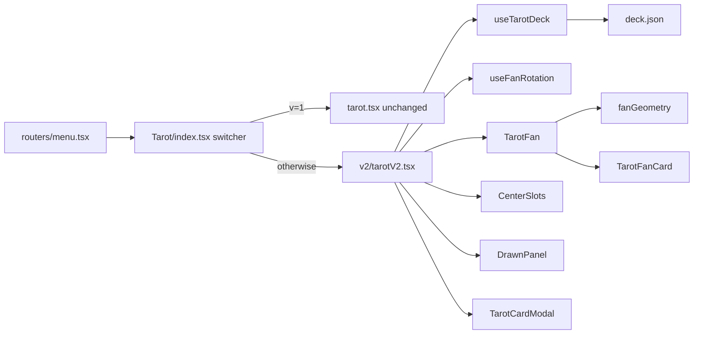

# Xác nhận ý tưởng

### Tôi hiểu ý tưởng như sau

Thay vì grid phẳng 78 lá hiện tại, bộ deck sẽ được xếp thành **một cung tròn (fan / quạt)** ở phía dưới màn hình: các lá toả ra từ một tâm ảo, mỗi lá nghiêng theo góc bán kính, chồng nhẹ lên nhau như đang cầm cả bộ trên tay.

Người dùng **kéo (drag) hoặc swipe** ngang để **xoay** cung tròn đó, có quán tính khi thả tay. Click vào một lá trên cung → lá đó **tách khỏi vòng, bay vào vùng trung tâm** và flip lộ mặt hình. Tối đa `maxDrawCount` (1 hoặc 3) lá nằm thành **hàng ngang ở tâm**.

### Điểm quan trọng: đây là bản V2 song song

Toàn bộ UI cũ **được giữ nguyên, không sửa một dòng nào** trong `src/pages/Tarot/tarot.tsx` và `tarot.styled.ts`. Bản fan xoay là một implementation mới, nằm riêng. Chọn version qua **query param**: `/tarot?v=1` → V1 (UI cũ), mọi trường hợp khác (không có `v`, hoặc `v` ≠ `1`) → V2. Không lưu storage, không có toggle trên UI.

### Hành vi được chốt từ trao đổi

| Chủ đề         | Quyết định                                                         |
| -------------- | ------------------------------------------------------------------ |
| Hình dạng      | Cung tròn / quạt (không phải vòng 360° kín)                        |
| Xoay           | Kéo chuột / swipe, có quán tính (inertia)                          |
| Chọn lá        | Lá bay ra giữa tâm và flip tại đó                                  |
| Nhiều lá       | 3 slot ngang cạnh nhau ở tâm                                       |
| Xem chi tiết   | Click vào lá đã được chọn (đang ở tâm) → mở `TarotCardModal`       |
| Trả lá về vòng | Nút `×` nhỏ trên lá ở tâm → lá bay trở lại vị trí của nó trên cung |

> Lưu ý nhỏ: bạn có nhắc cả "click lại vào lá ở tâm thì quay về" và "click vào lá đã chọn thì xem chi tiết". Tôi gộp thành: **click thân lá = xem chi tiết**, **nút `×` = trả về vòng**. Nếu bạn muốn ngược lại (click = trả về, nút nhỏ = chi tiết) thì chỉ cần đổi chỗ 2 handler.

# Requirements

### Overview & Goals

Nâng cấp trải nghiệm rút thẻ Tarot từ dạng grid tĩnh sang dạng **cung tròn xoay được**, tạo cảm giác "cầm cả bộ deck trên tay và xoè ra", đồng thời giữ nguyên toàn bộ bản cũ để có thể bật/tắt.

### Scope

**In Scope**

- Layout fan arc cho 78 lá, tính vị trí/góc bằng toán học (bán kính, góc mỗi lá).
- Gesture kéo/swipe để xoay cung, kèm quán tính và giới hạn (clamp) hai đầu.
- Animation lá bay từ cung vào 3 slot ngang ở tâm và bay trở lại.
- Giữ nguyên các tính năng nghiệp vụ hiện có: chọn số lá rút (1/3), shuffle, reshuffle, giới hạn số lá, panel "Drawn Cards", copy clipboard, bottom-sheet mobile, modal chi tiết.
- Chọn V1/V2 bằng query param `v` (`v=1` → V1, còn lại → V2), không persist, không toggle UI.

**Out of Scope**

- Thay đổi dữ liệu `deck.json` hoặc nội dung diễn giải.
- Thay đổi `TarotCardModal.tsx` (tái sử dụng nguyên trạng).
- Sửa bất kỳ dòng nào trong `tarot.tsx` / `tarot.styled.ts` (V1).
- Thêm thư viện animation/gesture mới (dùng CSS transform + pointer events thuần).

### User Stories

- Là người dùng, tôi muốn thấy cả bộ deck xoè thành cung tròn để cảm giác nghi thức rút thẻ chân thực hơn.
- Là người dùng, tôi muốn kéo/swipe để xoay cung và duyệt qua các lá ở xa.
- Là người dùng, tôi muốn lá mình chọn bay ra giữa màn hình và lật lên để nhìn rõ.
- Là người dùng, tôi muốn click vào lá đã lật để đọc phần mô tả và diễn giải đầy đủ.
- Là người dùng, tôi muốn trả một lá về vòng nếu chọn nhầm, không phải shuffle lại cả bộ.
- Là người dùng/dev, tôi muốn chuyển nhanh về UI cũ nếu bản mới có vấn đề.

### Functional Requirements

1. **Fan layout**: 78 lá xếp trên cung ~200° (cấu hình được), tâm cung nằm dưới đáy viewport; lá thứ `i` có `rotate(angle_i)` + `translateY(-radius)`, `z-index` tăng dần theo góc để chồng đúng hướng.
2. **Drag xoay**: `pointerdown/move/up` (hỗ trợ cả chuột và touch) cập nhật `rotation`; khi thả, giảm dần theo vận tốc cuối (inertia) rồi dừng; kéo không được trigger click chọn lá (phân biệt bằng ngưỡng di chuyển ~8px).
3. **Chọn lá**: click lá trên cung → nếu chưa đủ `maxDrawCount`, lá chuyển sang trạng thái `drawn`, animate về slot trung tâm tiếp theo và flip; nếu đã đủ → toast cảnh báo kèm nút "Draw Again" (giữ nguyên hành vi V1).
4. **Slot trung tâm**: hàng ngang tối đa 3 slot; lá lấp slot trống theo thứ tự rút.
5. **Xem chi tiết**: click thân lá ở tâm → mở `TarotCardModal` với card tương ứng.
6. **Trả về vòng**: nút `×` trên lá ở tâm → lá animate về đúng vị trí cũ trên cung, slot được giải phóng, counter giảm.
7. **Shuffle / Reshuffle**: giữ popup chọn "Draw 3 cards / Draw 1 card"; sau shuffle, cung tròn xuất hiện với stagger animation lan theo góc (thay cho stagger theo index của grid).
8. **Reversed card**: giữ logic `reverse` — mặt sau xoay 180°, illustration ở mặt trước xoay 180°, tên lá vẫn đọc được.
9. **Panel Drawn Cards / mobile sheet / copy**: hoạt động y như V1.
10. **Chọn version**: chỉ dựa vào URL. `?v=1` → render V1; không có `v` hoặc `v` khác `1` (vd `?v=2`, `?v=abc`) → render V2. Không dùng `localStorage`, không có nút toggle; đổi param trên URL là đổi version.

### Non-Functional Requirements

- Animation chỉ dùng `transform` / `opacity` để giữ 60fps với 78 node; không animate `width/height/top/left`.
- Responsive: bán kính và kích thước lá tính theo `vmin`/container size, hoạt động từ 360px đến desktop rộng.
- Tôn trọng `prefers-reduced-motion`: tắt inertia và animation bay, chuyển trạng thái tức thì.
- Accessibility: mỗi lá là element focusable với `aria-label` tên lá (hoặc "hidden card" khi chưa lật); nút `×` có `aria-label`.

# Technical Design

### Current Implementation

- `src/pages/Tarot/tarot.tsx` — toàn bộ state và UI trong một component: `cards`, `isShuffling`, `justShuffled`, `maxDrawCount`, `cardDetail`; render `.cards-container` là CSS grid, mỗi `.card` là khối flip 3D; `handleCardClick` lần 1 lật lá, lần 2 mở modal.
- `src/pages/Tarot/tarot.styled.ts` — 681 dòng styled-components: grid `repeat(auto-fill, minmax(120px,1fr))` (dòng 101-120), `.card` + flip 3D (128-321), shuffle overlay fan (396-490), responsive 768px/480px (553-677).
- `src/pages/Tarot/deck.json` — 78 lá, mỗi lá `{ name, suite, image, description, interpretation }`.
- `src/components/TarotCardModal.tsx` — antd `Modal`, tách `interpretation` thành upright/reversed, highlight theo `card.reverse`.
- `src/routers/menu.tsx` — `lazy(() => import('@pages/Tarot'))` trỏ vào `src/pages/Tarot/index.ts`.
- **Precedent**: `src/pages/Poker` đã dùng pattern `usePoker.ts` (logic hook) + `components/*` (presentational) + `types.ts` + `utils/*`. V2 sẽ noi theo pattern này.

### Key Decisions

1. **V2 là thư mục riêng, V1 bất động.** Tạo `src/pages/Tarot/v2/` chứa toàn bộ code mới. Không sửa `tarot.tsx` / `tarot.styled.ts`. Cần UI cũ = thêm `?v=1` vào URL.
2. **Switch nằm ở `src/pages/Tarot/index.ts` → đổi thành `index.tsx`.** Component switcher đọc query param `v` bằng `useSearchParams()` của `react-router-dom` (app dùng `createBrowserRouter` nên hook có sẵn): `v === '1'` → `<Tarot />` cũ, còn lại → `<TarotV2 />`. Không storage, không toggle. Router (`menu.tsx`) không cần đổi.
3. **Logic dùng chung được tách ra, không copy-paste.** `v2/useTarotDeck.ts` giữ phần deck/shuffle/draw-limit (port từ V1); `v2/useFanRotation.ts` giữ riêng phần gesture + inertia. V1 vẫn dùng code cũ của nó để đảm bảo bất động.
4. **Fan layout bằng CSS custom properties, không đo DOM.** Mỗi lá nhận `--angle` và `--radius` qua inline style; `transform: rotate(var(--angle)) translateY(calc(var(--radius) * -1))`. Vòng cha nhận `--rotation` từ hook → chỉ 1 property thay đổi khi kéo, cực nhẹ cho 78 node.
5. **Vị trí "bay ra tâm" tính bằng transform riêng, không di chuyển node trong DOM.** Lá đã rút giữ nguyên chỗ trong list nhưng nhận class `is-drawn` + `--slot-x` để `transform` override sang toạ độ slot ở tâm (kèm `position: fixed`-like bằng transform tuyệt đối trong container). Nhờ vậy animate về vòng chỉ là bỏ class → transition tự chạy ngược.
6. **Không thêm dependency.** Pointer Events + CSS transition/keyframes là đủ; tránh kéo thêm framer-motion vào bundle.

### Proposed Changes

**a. Switcher**

- `src/pages/Tarot/index.tsx` (thay `index.ts`): đọc `v` từ `useSearchParams()`, render V1 nếu `v === '1'`, ngược lại render V2. Không có state/storage/toggle.

**b. Hook deck (`v2/useTarotDeck.ts`)**

- Port logic từ V1: build deck từ `deck.json`, Fisher-Yates shuffle, `reverse` random, `SHUFFLE_DURATION_MS`, draw-limit toast, `reshuffle`, `getCardFlip`, `copyCard`.
- Bổ sung: `drawnOrder: number[]` (mảng index theo thứ tự rút, dùng để map vào slot), `drawCard(index)`, `returnCard(index)`.

**c. Hook gesture (`v2/useFanRotation.ts`)**

- State: `rotation`, `isDragging`.
- `onPointerDown/Move/Up/Cancel`, tính `deltaAngle` từ vị trí con trỏ quanh tâm cung (hoặc từ `deltaX` quy đổi — đơn giản và ổn định hơn).
- Inertia: lưu vận tốc mẫu cuối, `requestAnimationFrame` giảm dần với hệ số friction, clamp rotation trong `[minRotation, maxRotation]` để không xoay vô tận.
- Trả `didDrag` để component bỏ qua click sau khi kéo.

**d. Components**

- `v2/components/TarotFan.tsx` — container cung tròn, nhận `cards`, `rotation`, handlers; tính `--angle` cho từng lá.
- `v2/components/TarotFanCard.tsx` — một lá: mặt trước/sau, flip, trạng thái `is-drawn`, nút `×`, click → chi tiết.
- `v2/components/CenterSlots.tsx` — khung 3 slot ngang ở tâm (placeholder viền mờ khi trống).
- `v2/components/ShuffleOverlay.tsx` — port overlay shuffle hiện có.
- `v2/components/DrawModeDialog.tsx` — popup chọn 1/3 lá.
- `v2/components/DrawnPanel.tsx` — side panel + mobile bottom sheet + copy.

**e. Styles**

- `v2/tarotV2.styled.ts` — styled mới: `.fan`, `.fan-card`, `.center-slots`, `.is-drawn`, keyframes `fanIn`, `flyToCenter`; giữ lại phần nền/màu/mystical pattern từ V1 để đồng nhất thị giác.

**f. Page**

- `v2/tarotV2.tsx` — ghép hook + components, giữ `ToastContainer` và `TarotCardModal`.

### Data Models / Contracts

```ts
// v2/types.ts
export interface TarotCardV2 extends TarotCard {
  show: boolean; // đã lật
  drawn: boolean; // đã bay ra tâm
  slot: number | null; // 0..maxDrawCount-1
}

// v2/useFanRotation.ts
interface UseFanRotation {
  rotation: number; // deg
  isDragging: boolean;
  didDrag: () => boolean; // click guard
  bind: {
    onPointerDown: React.PointerEventHandler;
    onPointerMove: React.PointerEventHandler;
    onPointerUp: React.PointerEventHandler;
    onPointerCancel: React.PointerEventHandler;
  };
  reset: () => void;
}

// v2/fanGeometry.ts
export const getCardAngle = (index: number, total: number, arcDeg: number) =>
  -arcDeg / 2 + (arcDeg / (total - 1)) * index;
```

```ts
// src/pages/Tarot/index.tsx
import { useSearchParams } from 'react-router-dom';
import TarotV1 from './tarot';
import TarotV2 from './v2/tarotV2';

const TarotPage = () => {
  const [params] = useSearchParams();
  return params.get('v') === '1' ? <TarotV1 /> : <TarotV2 />;
};
export default TarotPage;
```

### File Structure

```
src/pages/Tarot/
  index.ts            → xoá, thay bằng index.tsx (switcher)      [MODIFIED]
  index.tsx           switcher: ?v=1 → V1, khác → V2            [NEW]
  tarot.tsx           V1 — KHÔNG SỬA                             [UNCHANGED]
  tarot.styled.ts     V1 — KHÔNG SỬA                             [UNCHANGED]
  deck.json           dùng chung                                 [UNCHANGED]
  v2/
    tarotV2.tsx                                                  [NEW]
    tarotV2.styled.ts                                            [NEW]
    types.ts                                                     [NEW]
    constants.ts        ARC_DEG, RADIUS_VMIN, FRICTION, ...       [NEW]
    fanGeometry.ts      hàm tính góc/bán kính/z-index            [NEW]
    useTarotDeck.ts                                              [NEW]
    useFanRotation.ts                                            [NEW]
    components/
      TarotFan.tsx                                               [NEW]
      TarotFanCard.tsx                                           [NEW]
      CenterSlots.tsx                                            [NEW]
      DrawnPanel.tsx                                             [NEW]
      DrawModeDialog.tsx                                         [NEW]
      ShuffleOverlay.tsx                                         [NEW]
src/components/TarotCardModal.tsx   tái sử dụng                  [UNCHANGED]
src/routers/menu.tsx                không đổi (vẫn import @pages/Tarot)
```

### Architecture Diagram



### Risks

- **Hiệu năng với 78 node có transform + backdrop**: mitigate bằng cách chỉ animate `--rotation` trên container, `will-change: transform` có chọn lọc, và `content-visibility`/`loading="lazy"` cho ảnh mặt trước.
- **Cung quá dày trên mobile (78 lá / 200°)**: bán kính và `arcDeg` khai báo trong `constants.ts` và override theo media query; nếu vẫn chật, tăng `arcDeg` và giảm chiều rộng lá.
- **Xung đột drag vs click**: giải bằng ngưỡng di chuyển + `didDrag()` guard, đã tính trong hook.
- **Drag vs scroll dọc trên mobile**: set `touch-action: none` trên vùng fan để không giật scroll trang.
- **Đổi `index.ts` → `index.tsx`**: phải chắc chắn `lazy(() => import('@pages/Tarot'))` vẫn resolve (Vite resolve cả `.tsx`) — sẽ verify bằng build.

# Testing

### Validation Approach

Không có test runner trong project (chỉ có `eslint.config.js` + `tsc`), nên validation sẽ dựa trên: TypeScript build, ESLint, và kiểm tra hành vi thực tế trong browser bằng Chrome DevTools CLI trên dev server của Vite.

### Key Scenarios

1. `/tarot` render V2; `/tarot?v=1` render đúng UI grid cũ; `/tarot?v=2` và `/tarot?v=abc` render V2; không có key nào được ghi vào `localStorage`.
2. Bấm "Shuffle Deck" → popup 1/3 lá → sau shuffle, 78 lá xuất hiện thành cung tròn với stagger.
3. Kéo ngang trên vùng fan → cung xoay theo; thả tay → tiếp tục trượt rồi dừng mượt.
4. Click 1 lá → lá bay vào slot 1 ở tâm và flip lộ hình; rút tiếp → lấp slot 2, 3.
5. Click lá đang ở tâm → `TarotCardModal` mở với đúng tên/description/interpretation, highlight đúng nhánh reversed.
6. Bấm `×` trên lá ở tâm → lá bay về đúng vị trí cũ trên cung, slot trống lại, counter giảm.
7. Panel "Drawn Cards" và nút copy trả về đúng chuỗi `Name (reversed)` phân tách bằng dấu phẩy.
8. Rút quá `maxDrawCount` → toast "You have drawn enough" + nút "Draw Again" reshuffle được.

### Edge Cases

- Kéo rồi nhả trên đúng một lá → **không** được tính là click chọn lá.
- Kéo tới hai đầu cung → rotation bị clamp, không xoay vô tận.
- Chế độ "Draw 1 card": chỉ 1 slot ở tâm, rút lá thứ 2 phải bị chặn.
- `maxDrawCount = 3` nhưng chỉ rút 1 lá rồi bấm `×` → về trạng thái 0 lá, cung nguyên vẹn.
- Viewport 360px và 1920px: cung không tràn ra ngoài, lá không bị đè lên panel/slot trung tâm.
- `prefers-reduced-motion: reduce`: không có inertia, lá đổi trạng thái tức thì, không lỗi layout.
- Reshuffle khi đang có lá ở tâm → tất cả lá về cung, slot reset.

### Test Changes

Không thêm test tự động (project chưa có hạ tầng test). Validation bằng `tsc --noEmit`, `eslint`, `vite build`, và kiểm tra bằng browser automation cho các scenario trên.

# Delivery Steps

### ✓ Step 1: Dựng switcher V1/V2 và khung trang V2

`/tarot?v=1` render V1 nguyên trạng, mọi URL khác của `/tarot` render khung trang V2.

- Thay `src/pages/Tarot/index.ts` bằng `index.tsx`: switcher đọc `v` qua `useSearchParams()` của `react-router-dom`.
- `v === '1'` → `<Tarot />` (V1, import từ `./tarot.tsx`, không sửa file); còn lại → `<TarotV2 />`. Không dùng storage, không toggle UI.
- Tạo `src/pages/Tarot/v2/types.ts` (`TarotCardV2` với `show`, `drawn`, `slot`) và `v2/constants.ts` (`ARC_DEG`, `RADIUS`, `SHUFFLE_DURATION_MS`, `FRICTION`, `DRAG_THRESHOLD_PX`).
- Tạo `v2/tarotV2.tsx` + `v2/tarotV2.styled.ts` ở mức khung: nền tím, layout main/side panel, nút "Shuffle Deck", empty state.
- Verify `lazy(() => import('@pages/Tarot'))` trong `routers/menu.tsx` vẫn resolve sau khi đổi sang `.tsx` bằng `tsc` + `vite build`.

### ✓ Step 2: Port logic deck sang hook useTarotDeck

V2 shuffle được bộ 78 lá, tôn trọng giới hạn số lá rút và xuất chuỗi lá đã rút, nhưng chưa có fan.

- Tạo `v2/useTarotDeck.ts`: build deck từ `deck.json`, Fisher-Yates shuffle, random `reverse`, `isShuffling` với `SHUFFLE_DURATION_MS`, `justShuffled`.
- Thêm `maxDrawCount`, `drawnOrder: number[]`, `drawCard(index)`, `returnCard(index)`, `reshuffle()`.
- Draw-limit: toast `You have drawn enough N cards` kèm nút "Draw Again" gọi `reshuffle` (giữ hành vi V1).
- Expose `getCardFlip` (`Name (reversed)` join bằng dấu phẩy) và `copyCard` dùng `navigator.clipboard`.
- Tạo `v2/components/DrawModeDialog.tsx` (Draw 3 / Draw 1) và `v2/components/ShuffleOverlay.tsx` (port stack fan từ `tarot.styled.ts` dòng 396-490), nối vào `tarotV2.tsx`.

### ✓ Step 3: Render cung tròn (fan arc) cho 78 lá

78 lá hiển thị thành cung tròn xoè ở phía dưới màn hình, chồng đúng lớp, responsive từ mobile tới desktop.

- Tạo `v2/fanGeometry.ts`: `getCardAngle(index, total, arcDeg)`, `getRadius(containerSize)`, `getZIndex(index)`.
- Tạo `v2/components/TarotFan.tsx`: container nhận `--rotation`, mỗi lá nhận inline `--angle` / `--radius`; `transform: rotate(var(--angle)) translateY(calc(var(--radius) * -1))`.
- Tạo `v2/components/TarotFanCard.tsx`: mặt sau (mystical pattern port từ V1) + mặt trước (`card-illustration` + `card-name`), flip 3D bằng `rotateY(180deg)`, xử lý `reverse` (mặt sau xoay 180°, illustration xoay 180°, tên vẫn đọc được).
- Thêm vào `tarotV2.styled.ts`: `.fan`, `.fan-card`, `touch-action: none`, keyframes `fanIn` với stagger lan theo góc thay cho stagger theo index.
- Điều chỉnh `ARC_DEG` / bán kính / kích thước lá theo media query 768px và 480px để cung không tràn viewport.

### ✓ Step 4: Thêm gesture kéo/swipe xoay cung có quán tính

Người dùng kéo chuột hoặc swipe để xoay cung, thả tay thì cung trượt tiếp rồi dừng, và thao tác kéo không làm chọn lá.

- Tạo `v2/useFanRotation.ts`: state `rotation` / `isDragging`, `bind` gồm `onPointerDown/Move/Up/Cancel` (dùng Pointer Events nên chạy cả chuột và touch).
- Quy đổi di chuyển con trỏ thành `deltaAngle`, cập nhật `rotation` theo thời gian thực.
- Inertia: lưu vận tốc các mẫu cuối, chạy `requestAnimationFrame` giảm dần theo `FRICTION` khi thả, cleanup rAF khi unmount.
- Clamp `rotation` trong `[minRotation, maxRotation]` để không xoay vô tận qua hai đầu cung.
- Expose `didDrag()` dựa trên `DRAG_THRESHOLD_PX`; `TarotFanCard` bỏ qua `onClick` nếu vừa kéo.
- Tôn trọng `prefers-reduced-motion`: tắt inertia, chỉ cập nhật rotation trực tiếp.

### ✓ Step 5: Lá bay ra 3 slot trung tâm, mở chi tiết và trả về vòng

Click lá trên cung thì nó bay vào slot ngang ở tâm và lật lên; click lá ở tâm mở modal chi tiết; nút × trả lá về đúng chỗ cũ trên cung.

- Tạo `v2/components/CenterSlots.tsx`: hàng ngang `maxDrawCount` slot với placeholder viền mờ khi trống.
- `drawCard`: gán `drawn: true`, `slot`, `show: true`; lá nhận class `is-drawn` + `--slot-x` để `transform` override sang toạ độ slot, transition mượt từ vị trí trên cung.
- Click thân lá đang ở tâm → set `cardDetail` → mở `TarotCardModal` (tái sử dụng nguyên trạng `src/components/TarotCardModal.tsx`).
- Nút `×` trên lá ở tâm (có `aria-label`) → `returnCard(index)`: bỏ class `is-drawn`, lá transition về đúng `--angle` cũ, giải phóng slot và giảm counter.
- Thêm keyframes / transition `flyToCenter` vào `tarotV2.styled.ts`, chỉ animate `transform` và `opacity`.

### Step 6: Hoàn thiện panel đã rút, mobile sheet và kiểm tra toàn luồng

V2 có đầy đủ panel "Drawn Cards", bottom sheet mobile, copy clipboard, và toàn bộ luồng được kiểm chứng trên browser.

- Tạo `v2/components/DrawnPanel.tsx`: side panel desktop (sticky, tiêu đề + nút copy `CopyOutlined`) và bottom sheet mobile + nút nổi `Drawn n/max`, port style tương ứng từ V1.
- Nối `getCardFlip` / `copyCard` / `shownCardCount` từ `useTarotDeck` vào panel; ẩn side panel và bật sheet ở breakpoint 768px.
- Thêm accessibility: mỗi lá focusable với `aria-label` theo tên lá (hoặc "hidden card" khi chưa lật).
- Chạy `tsc --noEmit`, `eslint`, `vite build` để chắc không lỗi type/lint và `@pages/Tarot` vẫn resolve.
- Kiểm tra trên dev server: shuffle → fan xuất hiện, kéo xoay + quán tính, rút 1/3 lá vào slot, mở modal, `×` trả lá về, vượt giới hạn hiện toast, `?v=1` ra V1 còn không có/khác `1` ra V2, thử ở 360px và desktop, và với `prefers-reduced-motion: reduce`.
